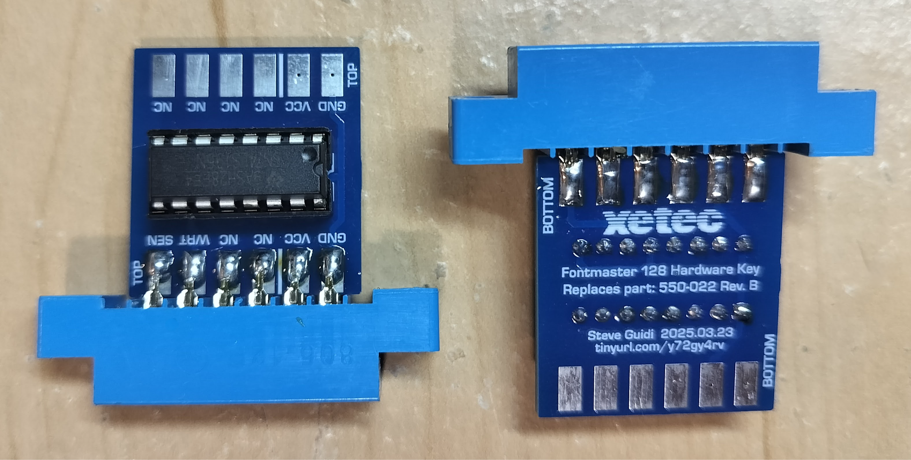
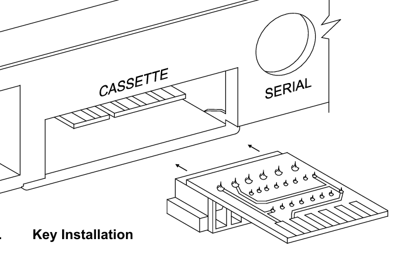
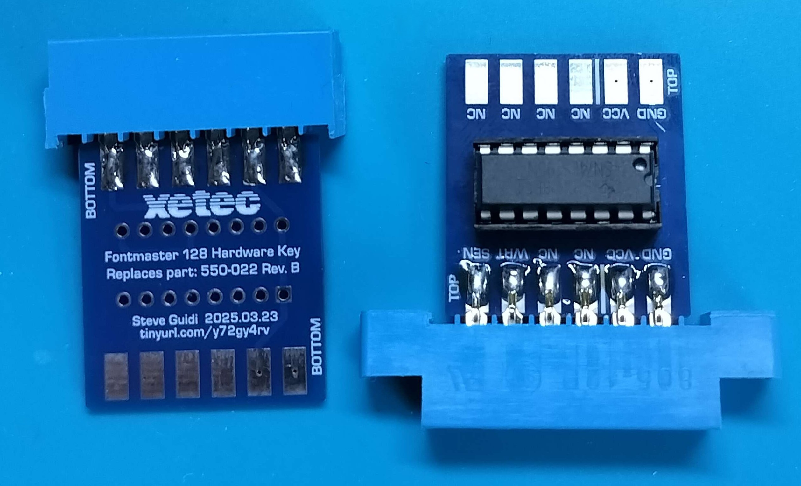

# fontmaster-128-dongle

## Overview
This is a reproduction hardware key/dongle for the Xetec Fontmaster 128 software, released for the Commodore 128 in 1986.  A friend asked me to help make a replica board to assist people completing collections and replace lost hardware.  We had no interest in breaking copy protection with this project as there are far easier methods to get a copy of working 40-year-old software than replicating the hardware dongle.

The original Xetec part (depicted in the images folder for the repo) is identified by the `550-022 Rev.B` version number and is implemented using a 74X195 shift register.  The PCB is configured to recieve a clock signal from a cassette port pin, shift a hard-wired sequence of bits, and provided measurement of the sequence through another cassette port pin.

# Installation and Usage

The dongle plugs into the cassette port and is required for the Fontmaster 128 software to function properly; as such, it implements a basic form of copy protection.  Please note the correct orientation of the dongle when inserting into the computer, as depicted in the following diagram from the [software instruction manual](https://www.retro-commodore.eu/download.php?file=Xetec_Fontmaster_128.pdf).  Both the original and this reproduction DO NOT include a keyed edge connector!

To use the dongle in a C128D, cut and remove the screwhole mounting blocks from the sides of the edge connector.  All other C128 computers will accept the dongle.as-built.

---
Shield: [![CC BY-SA 4.0][cc-by-sa-shield]][cc-by-sa]

This work is licensed under a
[Creative Commons Attribution-ShareAlike 4.0 International License][cc-by-sa].

[![CC BY-SA 4.0][cc-by-sa-image]][cc-by-sa]

[cc-by-sa]: http://creativecommons.org/licenses/by-sa/4.0/
[cc-by-sa-image]: https://licensebuttons.net/l/by-sa/4.0/88x31.png
[cc-by-sa-shield]: https://img.shields.io/badge/License-CC%20BY--SA%204.0-lightgrey.svg
